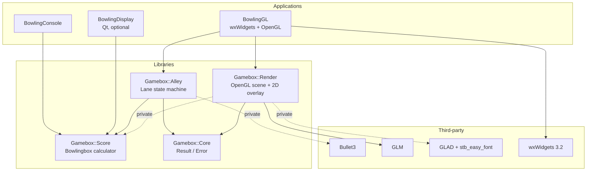
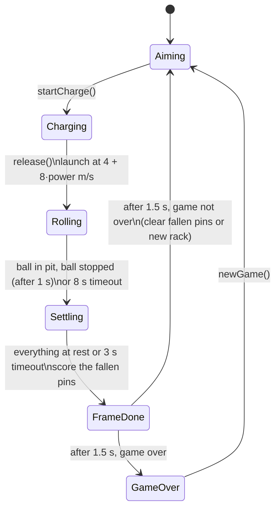
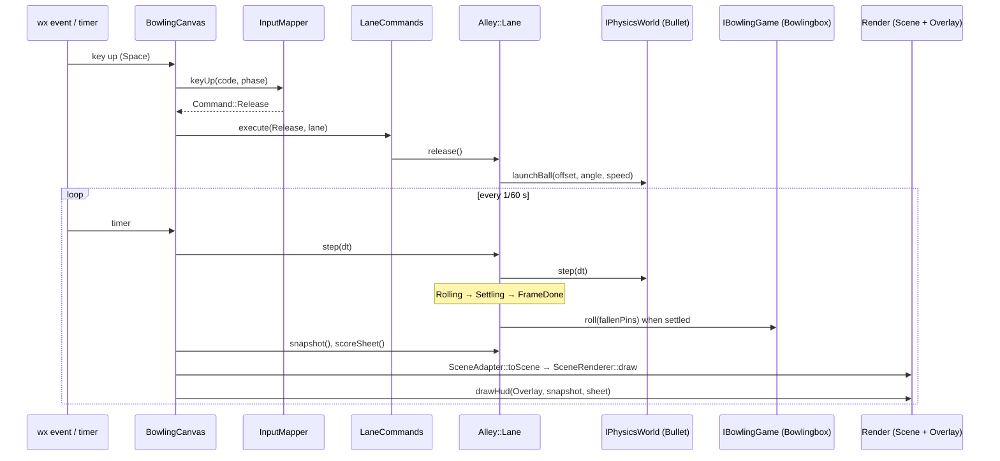

# Gamebox architecture

This document explains how Gamebox is put together: the libraries, the interfaces between them,
how a throw travels through the system, and how the build and tests are organised. For building
and playing, see the [manual](MANUAL.md).

## Overview

Gamebox is a set of small C++20 libraries plus thin front-ends. Every library exposes its
collaborators as interfaces, and the concrete implementation is chosen in one place (an
application's `main` or a default constructor). This keeps physics, OpenGL and terminals out of
the unit tests.



Dotted edges are private dependencies: they do not leak into the public headers or the installed
export set.

## Libraries

All public headers live under `libraries/<Lib>/include/Gamebox/<Lib>/` and are included as
`#include <Gamebox/<Lib>/...>`. Private headers stay in `src/`. Each library has a generated
export header (`Gamebox_<Lib>_export.h`) and builds with hidden symbol visibility, so only
classes marked `GAMEBOX_<LIB>_API` are exported.

### Gamebox::Score

The scoring rules of ten-pin bowling (the [codingdojo bowling kata](https://codingdojo.org/kata/Bowling/)).

| Header | Purpose |
|---|---|
| `IBowlingGame.h` | `IScoreSheet` (read-only view: `rolls`, `scores`, `score`, `frameScore`, `pinsLeft`, `isOver`) and `IBowlingGame` (adds `roll`, `reset`) |
| `Score.h` | `Bowlingbox`, the default `IBowlingGame` (pimpl over `BowlingSet`) |
| `Notation.h` | Constants (`kFrames = 10`, `kPins = 10`, `kRollSlots = 21`), the `Mark` sentinels and `notation()` |

**Roll encoding.** A game is stored as 21 roll slots (9 frames × 2 + 3 for the tenth) and 10
frame totals. A slot is either a pin count or a `Mark` sentinel:

| `Mark` | Value | Shown as |
|---|---|---|
| `Empty` | -4 | blank (the cell after a strike) |
| `None` | -3 | blank (not played yet) |
| `Strike` | -2 | `X` |
| `Spare` | -1 | `/` |
| `Miss` | 0 | `-` (or `0` in a score cell) |

Every display (Render, console, Qt) calls `notation()`, so they all show the same marks.

**Rules enforced.** `roll()` refuses negative counts, counts above `pinsLeft()` and any roll after
the game is over. `pinsLeft()` follows the tenth frame's rack and is 0 once the game is over. A
frame's entry in `scores()` stays `Mark::None` until it is final; `score()` and `frameScore()`
count the balls thrown so far.

### Gamebox::Core

Shared vocabulary types with no dependencies:

- `Result<T, E>`: a `std::variant` of a value and an error, with `isValue()`, `isError()`,
  `operator()` and `error()`. `Result<>` (value type `std::monostate`) is the return type of
  commands that can be refused.
- `Error<E>`: wraps an error (by default a `std::string`).

### Gamebox::Alley

The physical bowling lane and the rules of a single throw.

| Header | Purpose |
|---|---|
| `Types.h` | `Phase`, `LaneDimensions` / `kLane` (metres), aim limits, `Pose`, `Snapshot` |
| `PhysicsWorld.h` | `IPhysicsWorld` and the `makeBulletWorld()` factory |
| `Alley.h` | `Lane`, the public façade |

`Lane` exposes input (`moveAim`, `rotateAim`, `startCharge`, `release`, `newGame`), time
(`step(dt)`), and read access (`snapshot()`, `scoreSheet()`). The default constructor wires Bullet3
and `Bowlingbox`. The two-argument constructor accepts any `IPhysicsWorld` and `IBowlingGame`,
which is how the tests run without Bullet.

`IPhysicsWorld` knows nothing about bowling rules. It places and launches the ball, resets or
rebuilds the rack, removes pins, and reports poses, pin state and whether everything has come to
rest. `BulletWorld` (private, `src/BulletWorld.*`) implements it with Bullet3.

**Throw state machine** (`LaneImpl`, `src/Lane_impl.*`):



- Aiming commands are accepted only in `Aiming` and `Charging`. Any other command in the wrong
  phase returns an error `Result`, and the state does not change.
- While charging, power follows `0.5·(1 − cos 2πt)`: it rises from 0 to 1 and back once per
  second.
- A pin counts as down when it is still in the world but no longer standing. After the first ball
  of a frame, fallen pins are removed and standing pins stay where they are. After a strike, a
  spare or the end of a frame, the world is rebuilt with a full rack.

### Gamebox::Render

OpenGL 3.3 core rendering, independent of any windowing toolkit.

| Header | Purpose |
|---|---|
| `Render.h` | `Context` (one per GL context, loads GLAD, owns shaders), `Camera`, `SceneRenderer` (lane, gutters, ball, pins, aim guide), `Overlay` (OpenGL `ICanvas2D`), plain data `SceneGeometry` / `SceneDescription` / `Transform` |
| `Canvas2D.h` | `ICanvas2D`: `drawText`, `measureText`, `drawRect`, `strokeRect` in pixels |
| `ScoreboardLayout.h` | Pixel geometry of the 10-frame grid and `glyphFor()` |
| `ScoreboardPainter.h` | `paintScoreboard()`, which draws the grid through any `ICanvas2D` |
| `Geometry.h` | CPU mesh generators: box, sphere, cylinder, lathe, bowling pin |

Render does not include Alley: the application copies `Alley::kLane` into a `SceneGeometry`. The
scoreboard and HUD draw through `ICanvas2D`, so they can be tested with a recording fake instead of
a GL context. `Context::create()` returns a `Result` and fails cleanly when no GL 3.3 context is
current.

## Applications

### BowlingGL (`applications/bowlingGame/bowlingGameGL`)

| Unit | Responsibility |
|---|---|
| `main.cpp` | wx entry point; forces `GDK_BACKEND=x11` on Wayland (wxGLCanvas needs GLX) |
| `BowlingFrame` | Window, menu (Game ▸ New/Quit, Help ▸ Controls/About), status bar |
| `BowlingCanvas` | `wxGLCanvas`: owns the GL resources and the `Lane`, runs the 60 Hz timer, forwards wx events |
| `Command.h` | Player intents (`MoveLeft`, `AngleRight`, `StartCharge`, `Release`, `NewGame`, `Quit`, …) |
| `InputMapper` | Pure function: key or mouse event + current `Phase` → `Command` |
| `LaneCommands` | `execute(Command, Lane&)` → `Result<>` |
| `FollowCamera` | Waits behind the foul line, follows the ball down the lane, eases back |
| `SceneAdapter` | The only place that converts Alley floats into Render/GLM types |
| `Hud`, `HudText` | Scoreboard, power bar, hint and result text; `HudText` holds the strings |

### BowlingConsole (`bowlingGameCMD`)

`Console::Screen` runs the menu and game loop. It receives an `IBowlingGame` and an `ITerminal`
(`SystemTerminal` uses stdin/stdout). `ScoreGrid` draws the score sheet as text.

### BowlingDisplay (`bowlingGameUI`, optional)

A Qt Widgets form that shows a `Bowlingbox`. It is built only with `BUILD_QT_UI=ON`, because Qt is
a large external dependency with its own licence.

## Data flow: one throw in BowlingGL



The canvas never changes game state directly. Every change goes through a `Command` and
`Lane`, and every frame is drawn from an immutable `Snapshot`.

## Interfaces and injection points

| Interface | Library | Default implementation | Test double |
|---|---|---|---|
| `Score::IScoreSheet` / `Score::IBowlingGame` | Score | `Score::Bowlingbox` | `FakeGame` in `test_Alley.cpp` |
| `Alley::IPhysicsWorld` | Alley | `makeBulletWorld()` | `FakeWorld` in `test_Alley.cpp` |
| `Render::ICanvas2D` | Render | `Render::Overlay` (OpenGL) | `RecordingCanvas` in `test_Render.cpp` and `test_Gameplay.cpp` |
| `Console::ITerminal` | BowlingConsole | `SystemTerminal` | `ScriptedTerminal` in `test_Console.cpp` |

## Build system

### Layout and conventions

- The root `CMakeLists.txt` sets the project (`Gamebox`, C++20) and the options, then includes
  `cmake/Common.cmake`.
- `Common.cmake` sets the language level, loads the helper modules, sets up clang-tidy, offline
  fetching and testing, and pulls in the third-party support modules.
- Binaries go to `<build-dir>/bin`, and libraries to `<build-dir>/lib` on Unix (`cmake/BuildLocation.cmake`).
- Warnings are `-Wall -Wextra -Wpedantic -Werror` (`/W4 /WX` on MSVC) for project targets
  (`cmake/modules/CompilerWarnings.cmake`).

### Helper functions (`cmake/BuildUtils.cmake`, `cmake/TestUtils.cmake`)

- `create_library(LIB_NAME … LIB_FILES … PUBLIC_DEPENDENCIES … PRIVATE_DEPENDENCIES … TEST_SOURCES …)`
  does the following:
  - creates the raw target `gamebox_<lib>` and the alias `Gamebox::<Lib>`
  - names the output `libGamebox<Lib>`
  - generates the export header
  - installs the target, its headers and its export set
  - builds `test_gamebox_<lib>` from the test sources
- `create_application(NAME … ENTRY Console|QT_ui|WX_ui …)` creates an executable of the right kind.
  Applications declare their variables in their own `CMakeLists.txt`, and
  `applications/bowlingGame/CMakeLists.txt` creates them in a loop.
- `build_gtest_executable(NAME test_… SRC … DEPENDS … DISCOVER ON)` registers the tests with
  `gtest_discover_tests` and labels them `unit`. Names must start with `test_` and be lowercase.

### Scaffold generator (`cmake/modules/LibraryGenerator.cmake`)

With `GENERATE_SCAFFOLD=ON`, any name in `GAMEBOX_LIBRARIES` (root `CMakeLists.txt`) that has no
directory yet is generated from `cmake/template/lib` (header, pimpl, CMake file, test). A matching
app is generated from `cmake/template/app` (console, Qt or wx entry). Existing directories are
never touched.

### Dependencies

| Dependency | Version | How | Used by |
|---|---|---|---|
| Bullet3 | 3.25 | FetchContent, static, `-fPIC` (`BulletSupport.cmake`) | Alley (private) |
| GLM | 1.0.1 | FetchContent, header-only (`GlmSupport.cmake`) | Render |
| wxWidgets | 3.2.8 | FetchContent, static, GTK3 (`WxSupport.cmake`) | BowlingGL |
| GoogleTest | v1.15.2 | FetchContent (`GTestSupport.cmake`) | all tests |
| GLAD 2, stb_easy_font | in tree | `3rdparty/` | Render (private) |
| Qt 6 | system | `find_package` (`QtSupport.cmake`) | BowlingDisplay |

Versions are cache variables (`GAMEBOX_BULLET_VERSION`, `GAMEBOX_GLM_VERSION`,
`GAMEBOX_WX_VERSION`, `GAMEBOX_GTEST_VERSION`).

### Install and export

`cmake --install` installs the libraries, their headers and a CMake package
(`lib/cmake/Gamebox/GameboxConfig.cmake`, versioned with `SameMajorVersion`). Another project can
then use:

```cmake
find_package(Gamebox 1.4 REQUIRED)
target_link_libraries(my_app PRIVATE Gamebox::Score)
```

Bullet, GLAD and stb are linked as `$<BUILD_INTERFACE:…>`, so they are not part of the installed
interface. Code that includes `Gamebox/Render/Render.h` must find GLM itself.

## Testing

| Executable | Covers |
|---|---|
| `test_gamebox_score` | Scoring rules, encoding, notation |
| `test_gamebox_core` | `Result` / `Error` |
| `test_gamebox_alley` | State machine with real Bullet (`test_alley`: gutter, strike, 300 game, determinism) and with `FakeWorld` / `FakeGame` (`test_alley_injected`) |
| `test_gamebox_render` | Mesh generators, scoreboard layout, `paintScoreboard` on a fake canvas |
| `test_bowlinggl` | Input mapping, lane commands, follow camera, HUD text and drawing; no window is opened |
| `test_bowlingconsole` | Console game loop with a scripted terminal: number parsing, out-of-range pins, end of input |

Anything that needs a real window or GL context is checked by hand with the checklist in
[applications/bowlingGame/README.md](../applications/bowlingGame/README.md).

## Continuous integration

- **`.github/workflows/ci.yml`**: on pushes to `main` and `feature/**`, and on pull requests to
  `main`, Ubuntu 24.04 with CMake 3.31 and Ninja:
  - configures with Debug, `BUILD_WX_UI=ON`, `BUILD_QT_UI=OFF` and `GENERATE_SCAFFOLD=OFF`
  - builds, then runs `ctest --label-regex unit`
  - installs the libraries and builds `ci/consumer` against them (`ci/install-smoke.sh`)
  - caches the FetchContent downloads
- **`.github/workflows/automerge.yml`**: squash-merges a pull request labelled `automerge` once CI succeeds on it, and only if the pull request still points at the tested commit.
