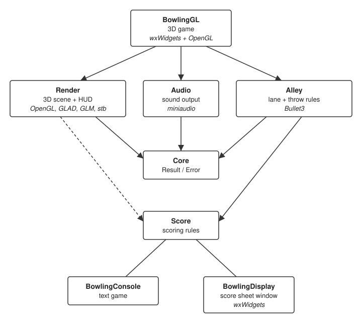
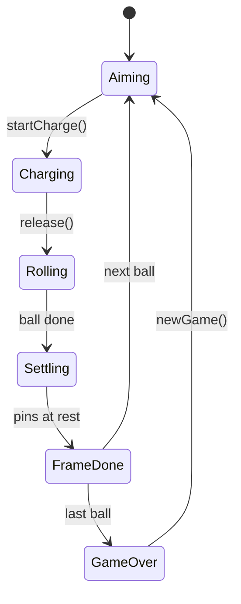
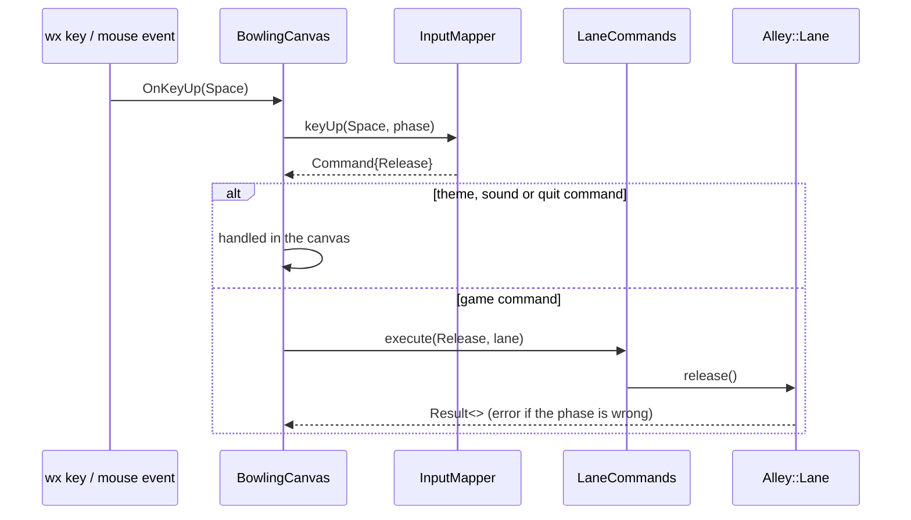
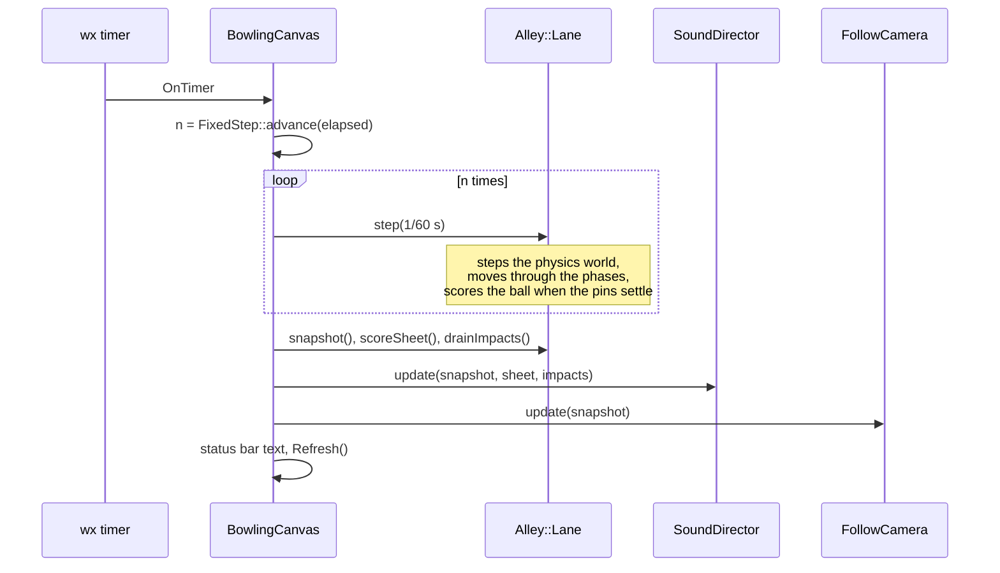
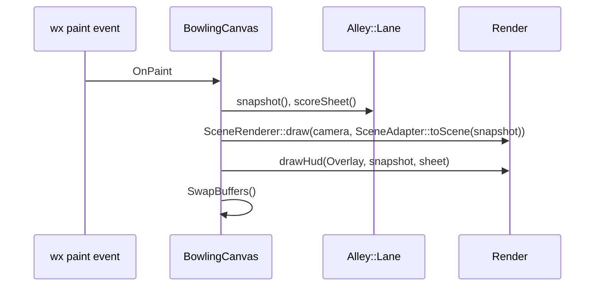

# Bowlingbox architecture

This document explains how Bowlingbox is put together: the libraries, the interfaces between them,
how a throw travels through the system, and how the build and tests are organised. For building
and playing, see the [manual](MANUAL.md).

## Overview

Bowlingbox is a set of small C++20 libraries plus thin front-ends. Every library exposes its
collaborators as interfaces, and the concrete implementation is chosen in one place (an
application's `main` or a default constructor). This keeps physics, OpenGL and terminals out of
the unit tests.

The diagram shows which Bowlingbox target links which: BowlingGL and its three libraries at the
top, then the two base libraries, Core and Score, and below Score the two front-ends that use only
Score.



The same links as a table:

| Target | Links publicly | Links privately |
|---|---|---|
| BowlingGL | Alley, Audio, Render, wxWidgets (core, base, gl), OpenGL | — |
| BowlingConsole | Score | — |
| BowlingDisplay | Score, wxWidgets (core, base) | — |
| Alley | Core, Score | Bullet3 |
| Render | Core, GLM | Score, GLAD, stb |
| Audio | Core | miniaudio |
| Score | — | — |
| Core | — | — |

- An arrow means "links against" and points at the library being used. BowlingConsole and
  BowlingDisplay sit below Score to keep the arrows from crossing, so their lines have no
  arrowhead: both link Score.
- A **solid** arrow is a public dependency: the library's headers use those types, so users of the
  library get it too (BowlingGL reaches `Score` through `Alley`). The **dotted** arrow is private:
  Render uses Score only inside `src/` to draw the scoreboard, and the link is not part of the
  installed package.
- The third-party code in *italics* in each box is listed in the table above; the
  [Dependencies](#dependencies) table has the versions.
- `Score` and `Core` are the base libraries and link nothing, not even each other: the scoring rules
  report a refused roll with their own `RollStatus`, not with `Result`.

## Libraries

All public headers live under `libraries/<Lib>/include/Bowlingbox/<Lib>/` and are included as
`#include <Bowlingbox/<Lib>/...>`. Private headers stay in `src/`. Each library has a generated
export header (`Bowlingbox_<Lib>_export.h`) and builds with hidden symbol visibility, so only
classes marked `BOWLINGBOX_<LIB>_API` are exported.

### Bowlingbox::Score

The scoring rules of ten-pin bowling (the [codingdojo bowling kata](https://codingdojo.org/kata/Bowling/)).

| Header | Purpose |
|---|---|
| `IBowlingGame.h` | `RollStatus`, `describe`, `IScoreSheet` (read-only view: `rolls`, `scores`, `score`, `frameScore`, `pinsLeft`, `isOver`) and `IBowlingGame` (adds `roll`, `reset`) |
| `Score.h` | `ScoreCalculator`, the default `IBowlingGame` (pimpl over `BowlingSet`) |
| `Notation.h` | Constants (`kFrames = 10`, `kPins = 10`, `kRollSlots = 21`), the `Mark` sentinels and `notation()` |
| `Frames.h` | `FrameView` and `frames()`: the 21 slots and 10 totals cut into ten frames (the tenth has three rolls) |

**Roll encoding.** A game is stored as 21 roll slots (9 frames × 2 + 3 for the tenth) and 10
frame totals. A slot is either a pin count or a `Mark` sentinel:

| `Mark` | Value | Shown as |
|---|---|---|
| `Empty` | -4 | blank (the cell after a strike) |
| `None` | -3 | blank (not played yet) |
| `Strike` | -2 | `X` |
| `Spare` | -1 | `/` |
| `Miss` | 0 | `-` (or `0` in a score cell) |

Every display (Render, console, BowlingDisplay) calls `notation()`, so they all show the same marks.

**Rules enforced.** `roll()` returns `RollStatus::Accepted`, or refuses with `GameOver` (checked first),
`Negative` or `TooManyPins` (more than `pinsLeft()`); `describe()` names each status. `pinsLeft()` follows the tenth frame's rack and is 0 once the game is over. A
frame's entry in `scores()` stays `Mark::None` until it is final; `score()` and `frameScore()`
count the balls thrown so far.

### Bowlingbox::Core

Shared vocabulary types with no dependencies, all in `Core.h`:

- `Bowlingbox::Result<T, E>`: a value or an error, with `isValue()`, `isError()`, `value()` and
  `error()`. Reading does not move: `r.value()` returns a reference, and `std::move(r).value()`
  takes the value out. The class is `[[nodiscard]]`, so an ignored refusal fails the `-Werror`
  build. `Result<>` (value type `std::monostate`) is the return type of commands that can be
  refused. Code inside `namespace Bowlingbox` writes `Result<>`; code outside writes
  `Bowlingbox::Result<>` or adds `using Bowlingbox::Result;` in a `.cpp`.
- `Bowlingbox::Core::Error<E>`: wraps an error (by default a `std::string`).

### Bowlingbox::Alley

The physical bowling lane and the rules of a single throw.

| Header | Purpose |
|---|---|
| `Types.h` | `Phase`, `LaneDimensions` / `kLane` (metres), aim limits, `Pose`, `Body` / `Impact` (contacts, for sound), `Snapshot` |
| `PhysicsWorld.h` | `IPhysicsWorld` and the `makeBulletWorld()` factory |
| `Alley.h` | `Lane`, the public façade |

`Lane` exposes input (`moveAim`, `rotateAim`, `startCharge`, `release`, `newGame`), time
(`step(dt)`), and read access (`snapshot()`, `scoreSheet()`, `drainImpacts()`). The default
constructor wires Bullet3 and `ScoreCalculator`. The two-argument constructor accepts any
`IPhysicsWorld` and `IBowlingGame`, which is how the tests run without Bullet.

`IPhysicsWorld` knows nothing about bowling rules. It places and launches the ball, resets or
rebuilds the rack, removes pins, and reports poses, pin state, ball speed and whether everything has
come to rest. It also buffers new contacts as `Impact`s (which two `Body` kinds touched, the impulse,
the position); `drainImpacts()` returns them oldest first and empties the buffer. `BulletWorld`
(private, `src/BulletWorld.*`) implements it with Bullet3.

**Throw state machine** (`LaneImpl`, `src/Lane_impl.*`):

Each ball goes once round the loop below. The player starts the first two transitions; `step(dt)`
drives the rest.



| Transition | Triggered by | What happens |
|---|---|---|
| Aiming → Charging | `startCharge()` (hold Space or the left button) | Power starts at 0 and follows `0.5·(1 − cos 2πt)`: up to 1 and back once per second |
| Charging → Rolling | `release()` | The ball is launched from the aim offset and angle at `4 + 8·power` m/s |
| Rolling → Settling | The ball is in the pit, or slower than 0.1 m/s after 1 s, or 8 s have passed | Physics keeps running so the pins can fall |
| Settling → FrameDone | Every body is at rest, or 3 s have passed | The fallen pins are counted and passed to `IBowlingGame::roll()` |
| FrameDone → Aiming | 1.5 s later, game not over | Full rack due (strike, spare, new frame): the world is rebuilt. Otherwise the fallen pins are removed and the standing ones stay where they are. The ball is placed again |
| FrameDone → GameOver | 1.5 s later, game over | Nothing; the scoreboard shows the final total |
| *any* → Aiming | `newGame()` | Score reset, world rebuilt, aim and power back to zero (not drawn: it is allowed from every phase) |

- `moveAim()` and `rotateAim()` are accepted only in `Aiming` and `Charging`. A command in the wrong
  phase returns an error `Result` and changes nothing.
- A pin counts as down when it is still in the world but no longer standing.

### Bowlingbox::Render

OpenGL 3.3 core rendering, independent of any windowing toolkit.

| Header | Purpose |
|---|---|
| `Render.h` | `Context` (one per GL context, loads GLAD, owns shaders), `Camera`, `SceneRenderer` (background, theme props, lane, gutters, ball, pins, aim guide), `Overlay` (OpenGL `ICanvas2D`), plain data `SceneDescription` |
| `Environment.h` | Themes (`ThemeId`, `Theme`, `Material`, `PointLight`, `theme()`, `themeFromName()`, `nextTheme()`), `SceneGeometry`, `Transform`, and the GL-free decor layout: `lanePitch()`, `hallHalfWidth()`, `buildProps()`, `shapeMesh()`, `localBounds()`, `bounds()` |
| `Lighting.h` | GL-free lighting maths: sRGB conversion, `fitLightFrustum()`, `shadowBox()`, `reflectionBox()`, `propsInBox()` |
| `RenderOptions.h` | `frameSizes()` (offscreen target sizes) and `renderOptions()` (reads `BOWLINGBOX_RENDER`, `BOWLINGBOX_RENDER_STATS`) |
| `FontAtlas.h` | The embedded Rubik font, baked into an atlas with stb_truetype for HUD text |
| `Canvas2D.h` | `ICanvas2D`: `drawText`, `measureText`, `drawRect`, `strokeRect` in pixels |
| `ScoreboardLayout.h` | Pixel geometry of the 10-frame grid and `glyphFor()` |
| `ScoreboardPainter.h` | `paintScoreboard()`, which draws the grid through any `ICanvas2D` |
| `Geometry.h` | CPU mesh generators: box, sphere, cylinder, lathe, bowling pin |

Render does not include Alley: the application copies `Alley::kLane` into a `SceneGeometry`. The
scoreboard and HUD draw through `ICanvas2D`, so they can be tested with a recording fake instead of
a GL context. `Context::create()` returns a `Result` and fails cleanly when no GL 3.3 context is
current.

The private units in `src/` wrap the GL objects and passes: `GlShader`, `GlMesh`, `GlTexture` and
`GlFramebuffer` (RAII wrappers), `Shaders` (GLSL sources), `ShadowMap`, `PostChain` (resolve, bloom,
tone map), `GpuTimer`, and `EnvironmentDecor` / `PropBuilders` (the per-theme prop lists behind
`buildProps()`). `ContextData` holds what a `Context` shares with its renderers. The Rubik font is
embedded at configure time by `bowlingbox_embed_file()` (`cmake/EmbedFile.cmake`).

The lit shader uses GGX specular, hemisphere ambient light, distance fog, emissive (glowing)
materials, procedural wood and ball patterns, and samples the key-light shadow map and the lane
reflection; a separate sky shader draws the background gradient on the far plane after the opaque
geometry, so it shades only the pixels nothing covers. Point lights skip fragments beyond their range,
and light rough surfaces (roughness ≥ 0.6) with Lambert diffuse only; the key light uses full GGX everywhere.
Theme props are unit boxes, cylinders and cones scaled by their `Transform`, so one mesh per shape
serves every prop, and `bounds()` uses the same extents as the meshes.

**Frame pipeline (full path).** `SceneRenderer::draw` runs, in order: a 1024×4096 shadow map from the key
light (fitted to `shadowBox`), a half-resolution mirror of the scene in the lane plane, the HDR main
pass (RGBA16F, up to 4× MSAA) and `PostChain::present` (weighted MSAA resolve, 4-level bloom, ACES tone map, sRGB) into
the 3D band. The *basic path* draws the main pass straight into the window, with tone mapping done in
the lit shader. It runs when `Context::create` finds no usable RGBA16F/MSAA target, a full-pipeline
shader fails, `GL_MAX_TEXTURE_SIZE` is below 4096 (the shadow map's height), or `BOWLINGBOX_RENDER=basic`
is set. It also takes over when the `SceneRenderer` finds its shadow map incomplete, and when the offscreen
targets turn out incomplete at a later resize.

**Testable without GL:** `Lighting.h` (sRGB, `fitLightFrustum`, `shadowBox`, `reflectionBox`,
`propsInBox`), `RenderOptions.h` (`frameSizes`, `renderOptions`) and `FontAtlas.h` (the embedded Rubik
font, baked with stb_truetype).

**GPU timing.** With `BOWLINGBOX_RENDER_STATS=1`, `GpuTimer` wraps each pass in a `GL_TIME_ELAPSED`
query, rotates through three query sets so results are read only once available (the CPU never waits),
and prints the per-pass averages to stderr about once a second. The numbers only measure cost when the
GPU is saturated: on a light load the GPU clock governor (notably on Intel) downclocks until the work
fills the frame, which inflates them. Measure fullscreen, at a high resolution.

### Bowlingbox::Audio

Sound output, independent of any game rules. Everything public is in `Audio.h`:

| Name | Purpose |
|---|---|
| `SoundId`, `kAllSounds` | The 13 embedded sounds (roll, gutter drop, pin hit and clatter, charge tone, release, strike, spare, new game, theme switch, three ambiences) |
| `LoopSlot` | `Roll`, `Charge`, `Ambient`: each slot plays at most one looping sound |
| `Voice` | Volume, pitch (playback rate) and pan of one sound |
| `IAudioOutput` | `play`, `setLoop` (same id updates the voice, another id restarts, `nullopt` stops), `setMuted`, `setVolume` (master gain) |
| `fileName()`, `embeddedData()`, `isLoop()`, `decodeInfo()` | The catalogue: the bytes of each sound and its format, readable without a device |
| `createDeviceOutput()`, `makeSilentOutput()` | The miniaudio output on the default device (returns an error `Result` without one), and the silent fallback |

The WAV files in `3rdparty/sounds` are compiled in by `bowlingbox_embed_file()`; configure stops if
a sound is missing or a WAV there is not listed in `SOURCES.md`. Private units: `Catalogue.cpp`,
`DeviceOutput.cpp` (miniaudio engine and voices), `SilentOutput.cpp`.

BowlingGL's `SoundDirector` decides what plays from the lane snapshot, the score sheet and
`Lane::drainImpacts()` (new Bullet contacts).

## Applications

Each app keeps everything except its entry point and its wx window classes in a static library
(`bowlinggl_core`, `bowlingconsole_core`, `bowlingdisplay_core`) that the executable and its test
both link.

### BowlingGL (`applications/bowlingGame/bowlingGameGL`)

`bowlinggl_core` links Alley, Audio, Render, `wx::core` and `wx::base`; the executable adds
`BowlingFrame`, `BowlingCanvas`, `main.cpp`, `wx::gl` and OpenGL.

| Unit | Responsibility |
|---|---|
| `main.cpp` | wx entry point; forces `GDK_BACKEND=x11` on Wayland (wxGLCanvas needs GLX) |
| `BowlingFrame` | Window, menu (Game ▸ New/Quit, View ▸ Theme, Sound ▸ Mute/Volume/Ambience, Help ▸ Controls/About), status bar; loads and saves `SoundSettings` with wxConfig |
| `BowlingCanvas` | `wxGLCanvas`: owns the GL resources and the `Lane`, runs the timer, forwards wx events |
| `FixedStep` | Turns irregular timer ticks into 1/60 s physics steps; drops the backlog after a stall |
| `Command.h` | `Command {type, amount}`: `MoveAim` (metres), `RotateAim` (degrees), `StartCharge`, `Release`, `NewGame`, `CycleTheme`, `ToggleMute`, `VolumeUp`, `VolumeDown`, `ToggleAmbience`, `Quit`; `targetOf()` sorts each type into `CommandTarget` (`Lane`, `View`, `Sound`, `App`), with no default case |
| `InputMapper` | Pure functions: key, button or mouse move + current `Phase` → `Command`; `KeyLatch` lets theme, mute and ambience fire once per key press (wx auto-repeats key-down) |
| `LaneCommands` | `execute(Command, Lane&)` → `Result<>` for `CommandTarget::Lane` commands |
| `FollowCamera` | Waits behind the foul line, follows the ball down the lane, eases back |
| `SceneAdapter` | The only place that converts Alley floats into Render/GLM types |
| `Hud`, `HudText` | Scoreboard, power bar, hint and result text; `hudLayout()` sizes the bands; `HudText` holds the strings, including the Controls dialog |
| `SoundDirector` | Decides what plays from the snapshot, the score sheet and the drained impacts, and drives an `Audio::IAudioOutput` (release, roll, gutter, pin hits, stingers, charge tone, ambience) |
| `SoundSettings.h` | The player's sound preferences (muted, volume in 10 % steps, ambience on/off) and the master gain (volume squared) |

### BowlingConsole (`bowlingGameCMD`)

`Console::Session` (`session.*`) is the game flow without I/O: `handle(line)` moves between `Menu`,
`Playing` and `GameOver` and sets the message; rolls are validated by `IBowlingGame::roll`.
`Console::Screen` (`bowlingScreen.*`) borrows an `IBowlingGame&` and an `ITerminal&` that `main` owns (`terminal.*`;
`SystemTerminal` uses stdin/stdout), draws `banner()` (`banner.*`), `renderScoreSheet()`
(`scoreGrid.*`) and the session's message and prompt, and feeds it input lines. `console.cpp` is the
entry point.

### BowlingDisplay (`bowlingGameUI`)

A wxWidgets frame that shows a `ScoreCalculator`. It is built with `BUILD_WX_UI=ON`, next to BowlingGL,
and links `wx::core` and `wx::base` (not OpenGL). The window is laid out in C++ with sizers.
`BowlingDisplay::MainWindow` (`ScoreSheetFrame.*`) names every widget so `wxWindow::FindWindowByName` finds it, and draws
the sheet from `Score::frames()`.

## Data flow in BowlingGL

`BowlingCanvas` reacts to three kinds of wx event. Input events change the game, timer events
advance it, and paint events draw it. They never overlap, so the canvas needs no locking.

### 1. Input: a key becomes a command

Releasing Space, for example:



`InputMapper` is a set of pure functions, so the whole key and mouse table is unit tested.

### 2. Timer tick: the game advances

The timer fires about every 16 ms, but ticks arrive irregularly. `FixedStep` turns the time since
the last tick into a whole number of 1/60 s steps (often 1, sometimes 0 or 2).



### 3. Paint: the frame is drawn

`Refresh()` makes wx send a paint event. Drawing reads the lane and never changes it.



The canvas never changes game state directly. Every change goes through a `Command` and
`Lane`, and every frame is drawn from an immutable `Snapshot`.

## Interfaces and injection points

| Interface | Library | Default implementation | Test double |
|---|---|---|---|
| `Score::IScoreSheet` / `Score::IBowlingGame` | Score | `Score::ScoreCalculator` | `FakeGame` in `test_Alley.cpp` |
| `Alley::IPhysicsWorld` | Alley | `makeBulletWorld()` | `FakeWorld` in `test_Alley.cpp` |
| `Render::ICanvas2D` | Render | `Render::Overlay` (OpenGL) | `RecordingCanvas` in `test_Render.cpp` and `test_Gameplay.cpp` |
| `Audio::IAudioOutput` | Audio | `createDeviceOutput()` (miniaudio), `makeSilentOutput()` without a device | `RecordingOutput` in `test_SoundDirector.cpp` |
| `Console::ITerminal` | BowlingConsole | `SystemTerminal` | `ScriptedTerminal` in `test_Console.cpp` |

## Build system

### Layout and conventions

- The root `CMakeLists.txt` reads the version (`cmake/GitVersion.cmake`), sets the project
  (`Bowlingbox`, C++20) and the options, then includes `cmake/Common.cmake`. It adds `3rdparty/`,
  `libraries/` (the list in `libraries/CMakeLists.txt`) and, with `BUILD_APPS`, `applications/`.
  The root `CMakeLists.txt` stops on a toolchain that is not 64-bit.
- `GitVersion.cmake` takes the project version from the nearest `vX.Y.Z` tag, falls back to the
  version written in the file without git or tags, and accepts `-DBOWLINGBOX_VERSION=X.Y.Z`. Each
  library keeps its own version in its `project()` call, which sets its `SOVERSION`.
- `Common.cmake` sets the language level, loads the helper modules, sets up clang-tidy, offline
  fetching and testing, and pulls in the third-party support modules. It also defines
  `BOWLINGBOX_STATIC_RUNTIME` (MinGW GCC: link the GCC runtime statically) and the install component
  `BOWLINGBOX_RUNTIME_COMPONENT` (`BowlingBox`), which holds exactly what the Windows installer ships.
- `3rdparty/CMakeLists.txt` builds the in-tree code as targets: `glad::glad`, `stb::easy_font`,
  `stb::truetype`, `miniaudio::miniaudio`, and the dev tool `sound_convert` (excluded from `all`).
- `cmake/EmbedFile.cmake` provides `bowlingbox_embed_file()`, which turns a file into a generated C++
  byte array at configure time (the Rubik font, the sounds).
- `cmake/windows-installer.cmake` is the initial cache for the Windows installer build
  (see [windows-installer.md](windows-installer.md)).
- Binaries go to `<build-dir>/bin`, and libraries to `<build-dir>/lib` on Unix (`cmake/BuildLocation.cmake`).
- Warnings are `-Wall -Wextra -Wpedantic -Werror` (`/W4 /WX` on MSVC) for project targets
  (`cmake/modules/CompilerWarnings.cmake`).

### Helper functions (`cmake/BuildUtils.cmake`, `cmake/TestUtils.cmake`)

- `create_library(LIB_NAME … LIB_FILES … PUBLIC_DEPENDENCIES … PRIVATE_DEPENDENCIES … TEST_SOURCES …)`
  does the following:
  - creates the raw target `bowlingbox_<lib>` and the alias `Bowlingbox::<Lib>`
  - names the output `libBowlingbox<Lib>`
  - generates the export header
  - installs the target, its headers and its export set
  - builds `test_bowlingbox_<lib>` from the test sources
- `create_application(NAME … ENTRY Console|WX_ui [COMPONENT …] SOURCES … DEPENDENCIES …)` creates an
  executable of the right kind; `COMPONENT` puts it in a named install component (BowlingGL uses
  `BOWLINGBOX_RUNTIME_COMPONENT`).
  It stops with an error for an unknown ENTRY or a disabled toolkit, so each wx app directory calls it
  directly, inside `if(BUILD_WX_UI)`. The app's logic goes in
  a static `<app>_core` library that the executable and its test both link.
- `build_gtest_executable(NAME test_… SRC … DEPENDS … DISCOVER ON [LABELS …])` registers the tests
  with `gtest_discover_tests` and labels them `unit` unless `LABELS` says otherwise
  (`test_bowlingdisplay` uses `unit;gui`). Names must start with `test_` and be lowercase.

### Scaffold generator (`cmake/modules/LibraryGenerator.cmake`)

With `GENERATE_SCAFFOLD=ON`, any name in `BOWLINGBOX_LIBRARIES` (root `CMakeLists.txt`) that has no
directory yet is generated from `cmake/template/lib` (header, pimpl, CMake file, test). A matching
app is generated from `cmake/template/app` (console or wx entry). Existing directories are
never touched.

### Dependencies

| Dependency | Version | How | Used by |
|---|---|---|---|
| Bullet3 | 3.25 | FetchContent, static, `-fPIC` (`BulletSupport.cmake`) | Alley (private) |
| GLM | 1.0.1 | FetchContent, header-only (`GlmSupport.cmake`) | Render |
| wxWidgets | ≥ 3.2 installed, else 3.2.8 | Installed CMake package or `wx-config` first (`BOWLINGBOX_USE_SYSTEM_WX=ON`), otherwise FetchContent, static, GTK3 (`WxSupport.cmake`) | BowlingGL, BowlingDisplay |
| GoogleTest | v1.15.2 | FetchContent (`GTestSupport.cmake`) | all tests |
| GLAD 2, stb_easy_font, stb_truetype, Rubik font | in tree | `3rdparty/` | Render (private) |
| miniaudio 0.11.25, 13 CC0 sounds | in tree | `3rdparty/miniaudio/`, `3rdparty/sounds/` | Audio (private) |
| stb_vorbis | in tree | `3rdparty/stb/` | `sound_convert` dev tool only, not shipped |

Versions are cache variables (`BOWLINGBOX_BULLET_VERSION`, `BOWLINGBOX_GLM_VERSION`,
`BOWLINGBOX_WX_VERSION`, `BOWLINGBOX_GTEST_VERSION`).

### Install and export

`cmake --install` installs the libraries, their headers and a CMake package
(`lib/cmake/Bowlingbox/BowlingboxConfig.cmake`, versioned with `SameMajorVersion`). Another project can
then use:

```cmake
find_package(Bowlingbox 1.4 REQUIRED)
target_link_libraries(my_app PRIVATE Bowlingbox::Score)
```

Bullet, GLAD, stb, miniaudio and GLM are linked as `$<BUILD_INTERFACE:…>`, so they are not part of
the installed interface. With the Windows installer the licence files are installed next to
`BowlingGL.exe` as well. Code that includes `Bowlingbox/Render/Render.h` must find GLM itself.

## Testing

| Executable | Covers |
|---|---|
| `test_bowlingbox_score` | Scoring rules, roll validation, the tenth frame, totals, notation, `frames()` |
| `test_bowlingbox_core` | `Result` / `Error` |
| `test_bowlingbox_alley` | State machine with real Bullet (`test_alley`: gutter, strike, 300 game, determinism, impacts) and with `FakeWorld` / `FakeGame` (`test_alley_injected`) |
| `test_bowlingbox_render` | Mesh generators, scoreboard layout, `paintScoreboard` on a fake canvas (`test_Render.cpp`); theme data, shape bounds, and decor that never enters the play corridor, sight line or camera path (`test_Environment.cpp`); sRGB, light frustum, shadow and reflection boxes (`test_Lighting.cpp`); the font atlas (`test_FontAtlas.cpp`); target sizes and environment options (`test_RenderOptions.cpp`) |
| `test_bowlingbox_audio` | The sound catalogue (every sound embedded and decodable within its length limit, loop flags, total size under 6 MB) and the silent output; no audio device is opened |
| `test_bowlinggl` | Input mapping, lane commands, fixed time step, follow camera, scene adapter, HUD layout, text and drawing, `SoundDirector` against a recording output, `SoundSettings`; no window is opened |
| `test_bowlingconsole` | `Session` (menu, rolls, game over, input trimming), score grid text against golden output, banner, and the game loop with a scripted terminal |
| `test_bowlingdisplay` | The wx score sheet: pin buttons, tenth frame, game over, restart (only with `BUILD_WX_UI=ON`). Needs a display or `xvfb-run` |

Anything that needs a real window or GL context is checked by hand with the checklist in
[applications/bowlingGame/README.md](../applications/bowlingGame/README.md).

## Continuous integration

- **`.github/workflows/ci.yml`**: on pushes to `main` and `feature/**`, and on pull requests to
  `main`, Ubuntu 24.04 with CMake 3.31 and Ninja:
  - configures with Debug, `BUILD_WX_UI=ON` and `GENERATE_SCAFFOLD=OFF`
  - builds, then runs `xvfb-run -a ctest --label-regex unit`
  - installs the libraries and builds `ci/consumer` against them (`ci/install-smoke.sh`)
  - caches the FetchContent downloads
  - checks out the full history, because CMake reads the version from the tags
- **`.github/workflows/automerge.yml`**: squash-merges a pull request labelled `automerge` once CI
  succeeds on it, and only if the pull request still points at the tested commit. It then calls
  `version.yml`, because a merge made with `GITHUB_TOKEN` starts no other workflow.
- **`.github/workflows/version.yml`**: while a pull request to `main` is open, shows the version it
  will get; once it is merged, tags the merge commit `vX.Y.Z` and publishes a GitHub release. The
  `semver:*` label picks the bump (`ci/version-bump.sh`, `ci/next-version.sh`); the default is patch.
- **`.github/workflows/windows-installer.yml`**: started by hand. It builds with MSYS2 UCRT64 GCC from
  `cmake/windows-installer.cmake`, runs the tests, stages and checks the install
  (`scripts/verify_installer_stage.ps1`), and packages it with Inno Setup (`installer/bowlingbox.iss`).
  See [windows-installer.md](windows-installer.md).
