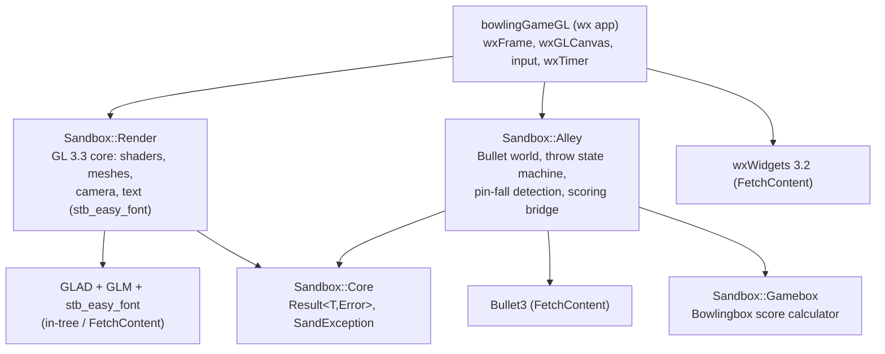
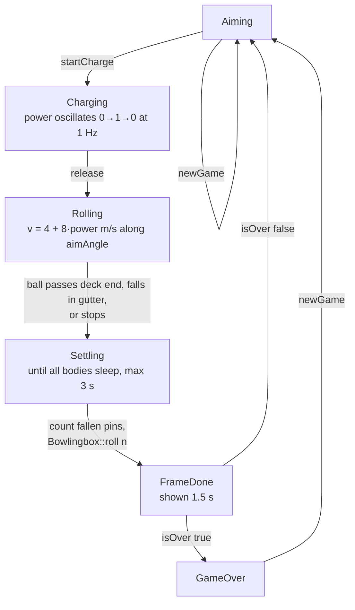
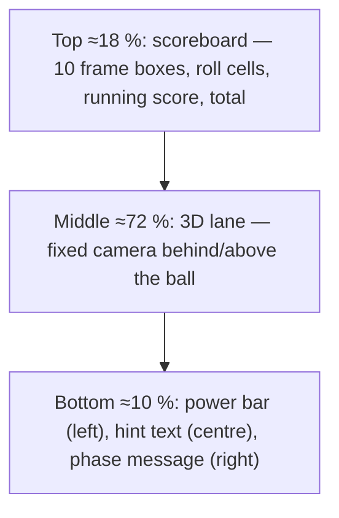
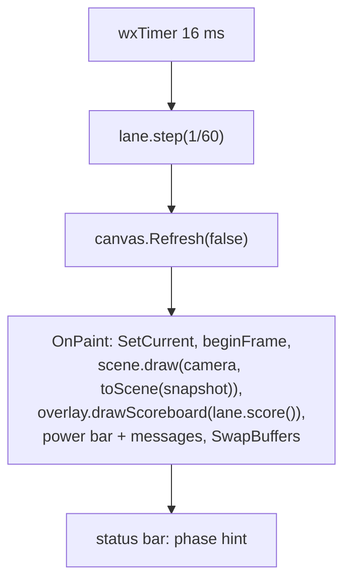

# Graphical Bowling Game (wxWidgets + OpenGL) — Design

Date: 2026-10-13
Status: approved for planning

## 1. Goal

Turn the Gamebox score calculator into a playable single-player bowling game.
Instead of selecting "how many pins fell", the player aims, charges and throws
a ball down a 3D lane; a rigid-body simulation decides which pins fall, and the
existing `Sandbox::Gamebox::Bowlingbox` computes the score.

Constraints:

- Language C++20, build with the existing CMake tooling (`create_library`,
  `create_application`).
- UI toolkit wxWidgets 3.2; Qt is not allowed for the new application (licence).
- Rendering OpenGL 3.3 core profile.
- Physics Bullet3 (zlib licence).
- `Sandbox::Core` (`Result<T, Error>`, `SandException`) is the error-handling
  vocabulary across library boundaries.
- One player only.

## 2. Architecture



Dependency rules:

- `Alley` has no graphics or wx dependency. It owns the Bullet world and exposes
  a read-only `Snapshot` (ball pose, pin poses and standing flags, phase, aim
  and power values). It calls `Bowlingbox::roll(n)` itself once the pins
  settle, so the score is always computed by Gamebox.
- `Render` has no bowling-rule or Bullet dependency. It draws plain transforms
  (lane, gutters, ball, pins, aim guide, power bar, text, scoreboard grid).
- The application is glue: GL context via `wxGLCanvas`, input mapping to
  `Alley` commands, a `wxTimer` ticking `Alley::step(dt)` at 60 Hz, then
  drawing the snapshot with `Render`.
- Every `Alley` operation that can fail returns `Result<>`. `Render` returns
  `Result` from context/shader creation so the app can show a message instead
  of a black canvas.
- `Gamebox` change: `Bowlingbox::roll` returns `bool` (the implementation
  `BowlingSet::roll` already does). Console and Qt apps are unaffected.
  Gamebox version 1.1.0 → 1.2.0.

## 3. `Sandbox::Alley` library

Location: `libraries/Alley`. Pimpl; Bullet is only included in `src/`.

### 3.1 Public API (`include/Sandbox/Alley/Alley.h`)

```cpp
namespace Sandbox::Alley {

enum class Phase { Aiming, Charging, Rolling, Settling, FrameDone, GameOver };

struct Pose {
    float position[3];   // metres, x lateral, y up, z along the lane
    float rotation[4];   // quaternion x, y, z, w
};

struct Snapshot {
    Phase phase;
    Pose  ball;
    std::array<Pose, 10> pins;
    std::array<bool, 10> pinStanding;  // standing at snapshot time
    float aimOffset;   // lateral ball position on the approach, m, [-0.6, 0.6]
                       // (lane half-width is 0.525, so |offset| > 0.525 is a gutter ball)
    float aimAngle;    // degrees, [-6, 6]
    float power;       // [0, 1] while charging, last used value otherwise
    int   lastPinsDown; // pins credited for the last throw, -1 if none yet
};

class Lane {
public:
    SANDBOX_ALLEY_API Lane();
    SANDBOX_ALLEY_API ~Lane();

    // Input; valid only in Aiming / Charging, otherwise Error.
    SANDBOX_ALLEY_API Result<> moveAim(float deltaOffset);
    SANDBOX_ALLEY_API Result<> rotateAim(float deltaAngle);
    SANDBOX_ALLEY_API Result<> startCharge();  // Aiming -> Charging
    SANDBOX_ALLEY_API Result<> release();      // Charging -> Rolling
    SANDBOX_ALLEY_API Result<> newGame();      // any phase -> Aiming

    // Time.
    SANDBOX_ALLEY_API void step(float dtSeconds) noexcept;

    // Read.
    SANDBOX_ALLEY_API Snapshot snapshot() const;
    SANDBOX_ALLEY_API const Gamebox::Bowlingbox& score() const;
};
}
```

`moveAim`/`rotateAim` clamp to the ranges above and return success even when
clamped; they return an error only in a wrong phase.

### 3.2 Phase machine



Rules:

- Fresh rack when `Bowlingbox::pinsLeft() == 10` after the roll (first ball of
  a frame, or after a strike/spare in the 10th); otherwise fallen pins are
  removed and standing pins stay where they are.
- A pin is fallen when its up axis tilts more than 45° or its centre leaves the
  pin deck area. Pins fallen in an earlier throw of the same frame are not
  counted again.
- `Bowlingbox::roll` returning `false` → `Error("roll rejected by Gamebox")`.
  `release()` outside Charging → `Error("not charging")`; `startCharge()`
  outside Aiming → `Error("not aiming")`; `moveAim`/`rotateAim` outside
  Aiming/Charging → `Error("ball in motion")`.
- The 3 s settling timeout guarantees the machine never stalls.

### 3.3 Physics (Bullet, `src/World.h/.cpp`)

- Units m / kg / s, gravity −9.81 m/s².
- Lane: 1.05 m wide, 18.3 m long, static box; gutters 0.24 m wide boxes on
  both sides, 0.05 m lower than the lane; approach 2 m before the foul line.
- Ball: sphere r = 0.109 m, 7 kg, friction 0.08, rolling friction 0.005,
  restitution 0.1.
- Pins: compound of two cylinders (0.38 m tall, max r 0.06 m), 1.5 kg, centre
  of mass lowered, friction 0.5, restitution 0.3; equilateral triangle, 0.3048 m
  spacing, head pin at z = 17.4 m.
- Fixed step: `stepSimulation(dt, 4, 1/120)` for deterministic results.
- No spin/hook in v1.

### 3.4 Tests (`test/src/test_Alley.cpp`, headless GTest)

- Centred throw, angle 0, power 0.7 → 10 pins fallen, Gamebox frame shows a
  strike.
- aimOffset 0.6 → gutter → 0 pins, Gamebox received `roll(0)`.
- `release()` in Aiming → `isError()`.
- Same inputs twice → identical `Snapshot` (determinism).
- 20 gutter balls via `step()` → `GameOver`, score 0.
- 12 centred strikes via `step()` → `GameOver`, score 300.

## 4. `Sandbox::Render` library

Location: `libraries/Render`. Pure OpenGL 3.3 core, no window system. Objects
require a current GL context at construction (app guarantees this).

### 4.1 Public API (`include/Sandbox/Render/`)

```cpp
namespace Sandbox::Render {

struct Transform { glm::vec3 position; glm::quat rotation; glm::vec3 scale{1.f}; };

class Context {
public:
    static Result<std::unique_ptr<Context>> create(); // GLAD load + shaders
    void resize(int w, int h);
    void beginFrame(const glm::vec3& clearColor);
    void endFrame();
};

class Camera {
public:
    void setViewport(int w, int h);
    void lookAt(glm::vec3 eye, glm::vec3 target);
    glm::mat4 view() const;
    glm::mat4 projection() const;
};

class Mesh {
public:
    static Mesh box(glm::vec3 halfExtents);
    static Mesh sphere(float r, int segments = 24);
    static Mesh cylinder(float r, float h, int segments = 24);
    static Mesh pin();   // lathe profile approximating a bowling pin
};

struct SceneDescription {
    Transform ball;
    std::array<Transform, 10> pins;
    std::array<bool, 10> pinVisible;
    bool showAimGuide; glm::vec3 aimFrom; glm::vec3 aimTo;
};

class SceneRenderer {
public:
    explicit SceneRenderer(Context&);
    void draw(const Camera&, const SceneDescription&);
};

class Overlay {   // 2D orthographic, drawn after the scene
public:
    explicit Overlay(Context&);
    void drawText(std::string_view, glm::vec2 px, float scale, glm::vec3 color);
    void drawRect(glm::vec2 px, glm::vec2 size, glm::vec4 color);
    void drawScoreboard(const std::vector<int>& rolls, const std::vector<int>& scores,
                        int total, glm::vec2 origin, float cellPx);
};
}
```

`drawScoreboard` uses the same encoding as the console/Qt grids:
−4/−3 → blank, −2 → `X`, −1 → `/`, 0 → `-`, else the number.

### 4.2 Shaders (embedded string literals)

- `lit`: MVP + normal matrix, one directional light, Lambert + ambient,
  uniform colour, optional second colour above a height threshold (pin neck
  band). Used for lane, gutters, ball, pins, and the semi-transparent aim guide.
- `flat2d`: orthographic position + colour; used by `Overlay` for
  `stb_easy_font` quads and rectangles.

### 4.3 Canvas layout (relative to canvas size)



### 4.4 Errors and tests

- `Context::create()` returns `Error` with the GL info log on shader
  compile/link failure or when GLAD cannot load 3.3. Draw calls never throw.
- Headless tests (`test/src/test_Render.cpp`): mesh generators (vertex/index
  counts, unit normals, pin height), scoreboard cell → pixel rect maths, glyph
  mapping. GL output is verified manually in the app.

## 5. Application `bowlingGameGL`

Location: `applications/bowlingGame/bowlingGameGL`, target `BowlingGL`.

Files:

- `main.cpp` — `wxApp` subclass, `OnInit` creates and shows `BowlingFrame`.
- `BowlingFrame.h/.cpp` — `wxFrame`, menu (`Game ▸ New Game Ctrl+N`,
  `Game ▸ Quit Ctrl+Q`, `Help ▸ Controls`, `Help ▸ About`), status bar,
  one `BowlingCanvas` child. Default 1280×800, resizable.
- `BowlingCanvas.h/.cpp` — `wxGLCanvas` with `wxGLContextAttrs`
  `CoreProfile().OGLVersion(3,3)`, canvas attribs RGBA, double buffer,
  depth 24. Owns `Alley::Lane`, `Render::Context`, `SceneRenderer`,
  `Overlay`, `Camera`, `wxTimer` (16 ms).
- `InputMapper.h/.cpp` — pure mapping of `wxKeyEvent`/`wxMouseEvent` + `Phase`
  to a `Command` enum; unit-testable without a window.
- `SceneAdapter.h/.cpp` — `toScene(const Alley::Snapshot&) -> Render::SceneDescription`
  (the only place converting `Pose` floats to GLM types).

### 5.1 Game loop



`Render::Context::create()` is called lazily on the first `OnPaint` once the
context is current; on failure the app shows `wxMessageBox(error)` and closes.
Fallen pins are drawn lying down until the phase returns to Aiming.

### 5.2 Controls

| Action | Keyboard | Mouse |
|---|---|---|
| Move ball left/right | ← / → (0.02 m per event, auto-repeat) | horizontal move while Aiming |
| Aim angle | A / D (0.25° per event) | right-button drag |
| Charge power | hold Space | hold left button |
| Release / throw | release Space | release left button |
| New game | Ctrl+N or N | — |
| Quit | Ctrl+Q or Esc | — |

Commands rejected by `Alley` (wrong phase) are logged with `wxLogDebug`, not
shown.

### 5.3 Overlay messages

| Phase | Text |
|---|---|
| Aiming | `← → move   A D angle   hold Space to charge` |
| Charging | `release to throw` |
| Rolling / Settling | (none) |
| FrameDone | `STRIKE!` / `SPARE!` / `N pins` / `Gutter` |
| GameOver | `Game over – score S   N: new game` |

## 6. Build system and repository changes

### 6.1 New CMake support (`cmake/`), included from `Common.cmake`

| File | Condition | Mechanism |
|---|---|---|
| `WxSupport.cmake` | `BUILD_WX_UI` | `FetchContent` wxWidgets v3.2.8 release tarball; `wxBUILD_SHARED OFF`, `wxBUILD_SAMPLES OFF`, `wxBUILD_TESTS OFF`, `wxBUILD_DEMOS OFF`, `wxBUILD_MONOLITHIC OFF`, `wxUSE_OPENGL ON`. Targets `wx::base wx::core wx::gl`. Host needs `libgtk-3-dev` (documented). |
| `BulletSupport.cmake` | always (`Alley` is always built) | `FetchContent` bullet3 3.25; demos, extras, unit tests OFF; static; interface target `Bullet::Bullet` wrapping `BulletDynamics BulletCollision LinearMath` + include dir. |
| `GlmSupport.cmake` | always (`Render` is always built) | `FetchContent` glm 1.0.1, target `glm::glm`. |
| `3rdparty/glad/` | in-tree | GLAD 2 generated loader, GL 3.3 core, with the built-in `gladLoaderLoadGL()` (dlopen) so `Render` needs no GL link dependency; target `glad::glad`. |
| `3rdparty/stb/` | in-tree | `stb_easy_font.h` (public domain); target `stb::easy_font`. |

All fetches are plain `FetchContent_Declare` and honour `SB_FETCH_OFFLINE`.
Only the application links `OpenGL::GL` (`find_package(OpenGL REQUIRED)` inside
`WxSupport.cmake`); the libraries build without GL or GTK development headers.

### 6.2 Changes to existing files

- `CMakeLists.txt`: add `Alley`, `Render` to `SANDBOX_LIBRARIES`;
  `option(BUILD_WX_UI "Build wxWidgets based applications" ON)`;
  `BUILD_QT_UI` default OFF (Qt app kept, buildable on demand); version 1.4.0.
- `libraries/CMakeLists.txt`: remove dangling `Pot`, `Tools`, `Geo`,
  `Codility`; add `Alley`, `Render`.
- `cmake/BuildUtils.cmake` `create_application`: add `WX_ui` branch
  (`add_executable`, `WIN32_EXECUTABLE`/`MACOSX_BUNDLE`, warnings, install);
  update the FATAL_ERROR message to `[Console|QT_ui|WX_ui]`.
- Third-party includes (Bullet, GLM, glad) are consumed as `SYSTEM` includes so
  `sandbox_set_warnings` stays clean.
- `libraries/Gamebox`: `bool Bowlingbox::roll(const int&)`; version 1.2.0;
  one new test for the return value.
- `applications/bowlingGame/CMakeLists.txt`: `add_subdirectory(bowlingGameGL)`.
- `applications/bowlingGame/README.md`: GL version, controls, prerequisites
  (`libgtk-3-dev`, `libgl1-mesa-dev`), manual test checklist.
- Scaffold: add wx templates (`lib_wx_ui_CMakeLists.txt.in`,
  `lib_Wx_UI.cpp.in`) and make `generate_libraries` skip app generation for
  libraries whose application directory already exists, so `GENERATE_SCAFFOLD`
  stays harmless for `Alley`/`Render`.
- `.gitignore` already covers `build/`, `.cache/`, `compile_commands.json`.

## 7. Error handling policy

- Library boundaries return `Result<T, Core::Error<>>`; exceptions do not cross
  a library boundary. `SandException` is used only internally where a
  constructor cannot report otherwise and is caught at the `Result`-returning
  factory.
- `Lane::step` is `noexcept`; physics never fails at runtime; the settling
  timeout bounds every phase.
- The app surfaces only fatal errors (GL context creation) via `wxMessageBox`.

## 8. Testing

- `test_sandbox_alley`: section 3.4.
- `test_sandbox_render`: section 4.4.
- `test_sandbox_gamebox`: existing + `roll()` return value test.
- `InputMapper` unit test in the app (key + phase → command).
- Manual GL checklist (README): launch, play a full game, resize, New Game
  mid-roll, quit with no GL errors on stderr.
- Must pass: `cmake -S . -B build && cmake --build build -j && ctest --test-dir build`
  with `BUILD_WX_UI=ON` and with `BUILD_WX_UI=OFF` (libraries + console build
  without GTK/GL).

## 9. Acceptance criteria

1. `BowlingGL` shows a 3D lane, ten pins, a ball, and an empty scoreboard.
2. The player can aim, charge and throw with keyboard or mouse; pins fall
   physically; the correct pin count and running score appear in the Gamebox
   grid (same encoding as console/Qt).
3. Second balls keep standing pins; strikes, spares and 10th-frame bonus balls
   follow `Bowlingbox::isOver()`.
4. New Game works in any phase; Quit exits cleanly.
5. All ctest targets pass; Qt is not required to build.

## 10. Out of scope

Multiple players, ball spin/hook, sound, textures, replay camera, settings
persistence, high-score table, Windows/macOS packaging.
